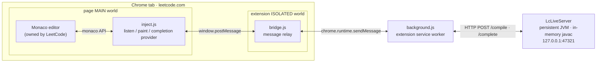
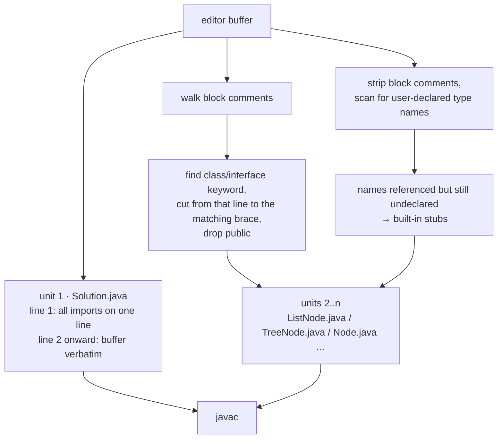
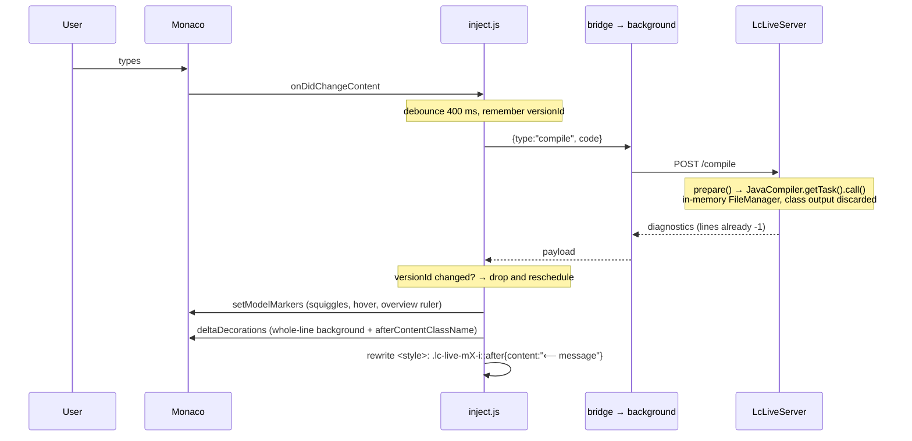
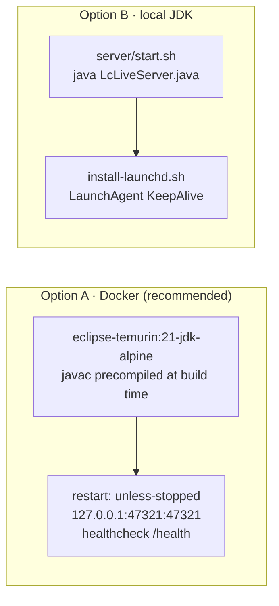

# lc-live Design Document

English | [中文](DESIGN.zh-CN.md)

| | |
|---|---|
| Status | Implemented (v0.1) |
| Author | haotian-zz |
| Date | 2026-10-17 |
| Scope | Java; Chrome; macOS, run locally or in Docker |

## 1. Background and problem

When solving LeetCode problems in Chrome, the editor only tells you that your code does not compile after you press "Run". LeetCode's built-in "Auto" assistant (IntelliSense and checking) depends on a remote service that frequently disconnects, lags, or silently stops working. It is not something a workflow can rely on.

We want two basic IDE capabilities, running entirely on the local machine with no dependency on any LeetCode backend:

1. **Live compile diagnostics**: within a few hundred milliseconds of pausing, offending lines show a squiggle and an end-of-line hint.
2. **Completion**: class-name prefixes, members after `.` (with generics substituted in the signature), and variables and methods in scope.

## 2. Goals and non-goals

**Goals**

- End-to-end latency on the order of 100 ms for both diagnostics and completion, so it feels instant.
- Diagnostics that agree with what javac says on a real LeetCode submission: the same implicit imports and the same helper types (`ListNode`, `TreeNode`, `Node`, parents of interactive problems).
- Zero third-party dependencies. The server uses only JDK APIs; the extension uses only Chrome APIs.
- Non-invasive: no changes to LeetCode's DOM structure, no interception of its network traffic, and it can be switched off at any time.
- One-command deployment with the server restarting automatically with the system.

**Non-goals**

- Running user code or test cases.
- Full language-server features such as refactoring, go-to-definition or formatting.
- Languages other than Java for now (the architecture reserves a `languages` field).
- Editors outside LeetCode pages.

## 3. Architecture overview

Three processes cooperate: the Monaco editor inside the LeetCode page, the Chrome extension, and a persistent JVM compile server on the local machine.



### 3.1 Why three hops

The path looks roundabout, but each hop is forced by Chrome's isolation model:

| Constraint | Consequence |
|---|---|
| `window.monaco` is a JavaScript object owned by the page; content scripts run in the ISOLATED world by default and cannot see page variables | Code that touches the editor must be injected with `world: "MAIN"` |
| MAIN-world scripts have no extension APIs such as `chrome.runtime` | A relay script in the ISOLATED world is needed; the two talk via `postMessage` |
| A `fetch("http://127.0.0.1")` from `https://leetcode.com` trips Chrome's local-network-access restriction (verified: the request hangs) | The request is ultimately made by the extension service worker, which holds `host_permissions` and is exempt |

### 3.2 Component responsibilities

| Component | File | Responsibility |
|---|---|---|
| Injected script | `extension/inject.js` | Polls for `window.monaco`; tracks every model whose language is `java`; debounces and sends compile requests; paints diagnostics as markers, whole-line background and end-of-line hints; registers a `CompletionItemProvider`; shows the status pill |
| Relay | `extension/bridge.js` | Forwards page messages to the service worker and responses back. No business logic |
| Service worker | `extension/background.js` | The only component that talks to the compile server. Timeouts, port configuration (`chrome.storage`), health check |
| Popup | `extension/popup.*` | Shows server status; lets the user change the port |
| Compile server | `server/LcLiveServer.java` | HTTP server; source assembly; in-memory javac; Trees-API-based completion; class-name index |
| Deployment | `Dockerfile`, `compose.yml`, `server/*.sh` | Container (JDK 21) or local launchd, both with automatic restart |

## 4. Server API

The server listens on the loopback address only. Request bodies are raw Java source (`text/plain`), which avoids writing a JSON parser in a dependency-free server.

### `GET /health`

```json
{"ok":true,"service":"lc-live","java":"21.0.12.1","languages":["java"],
 "features":["diagnostics","completion"],"indexedTypes":493}
```

### `POST /compile`

Body: the editor buffer verbatim.

```json
{"ok":false,"ms":16,"diagnostics":[
  {"line":9,"col":20,"endLine":9,"endCol":21,"severity":"error",
   "message":"incompatible types: int cannot be converted to String"}]}
```

Lines and columns are 1-based and already mapped back to the user's buffer coordinates.

### `POST /complete`

Body: the buffer verbatim. Header `X-Lc-Offset`: the caret's UTF-16 offset in the buffer (identical to Monaco's `getOffsetAt`).

```json
{"ok":true,"ms":12,"incomplete":false,"items":[
  {"label":"peek","kind":"method","detail":"() : Integer","doc":"Deque",
   "insert":"peek()","snippet":false,"sort":"1peek"}]}
```

`incomplete=true` means the list was truncated (for example, the full JDK type list is not returned for an empty prefix); Monaco re-queries as the user keeps typing.

## 5. Source assembly (prepare)

When LeetCode submits, it wraps the user's code: a set of packages is imported implicitly and the problem's helper types are compiled alongside. To make local javac agree with the online judge, the server performs the same assembly on every request.



Design points:

- **All imports on a single line.** User lines shift by exactly 1, so mapping a diagnostic back is a subtraction; multi-line imports would make the mapping depend on how many imports there are.
- **Definitions in comments really are compiled.** LeetCode places `ListNode` and friends in a `/** ... */` block at the top of the file, sometimes as `/* // Definition for a Node. class Node {...} */`. The server strips the `*` and `//` prefixes, then starts at the line containing the `class` keyword and cuts to the matching `}` by brace counting. The surrounding prose falls away naturally.
- **Stubs only when missing.** Built-in stubs exist for `ListNode`, `TreeNode`, `Node` (fields are the union across problems), `NestedInteger`, `GuessGame`, `VersionControl`, `MountainArray` and others. A stub is injected only if neither the user's code nor a comment already declares that name, avoiding duplicate-class errors.
- **Helper types are separate compilation units.** They do not consume lines of the user's buffer. If a stub itself fails to compile, the diagnostic is pinned to line 1 with an `[in X.java]` prefix rather than being misplaced.
- **Unit naming.** If the user's code contains `public class X`, the main unit is named `X.java`, otherwise `Solution.java`, satisfying javac's file-name rule for public classes.

## 6. Diagnostics pipeline



### 6.1 Compiler options

```
-proc:none -Xlint:none -g:none -Xmaxerrs 200 -encoding UTF-8 -XDshould-stop.ifError=FLOW
```

`-XDshould-stop.ifError=FLOW` is the important one. By default javac stops after parsing when it sees a syntax error and reports only `';' expected`. With this flag it continues through attribution and flow analysis, so a missing semicolon and an undefined variable are reported together, which is what an IDE does.

### 6.2 Error ranges

javac supplies character offsets `start/end`. For zero-width diagnostics (a missing semicolon points at the end of the previous token) the server extends the range to the end of the identifier, or by at least one column, so Monaco has a visible squiggle, without crossing a line break. The client clamps the range once more against the model's real line lengths.

### 6.3 Why the end-of-line hint is a CSS pseudo-element

Monaco offers two ways to draw text at the end of a line:

| Approach | Mechanism | Problem |
|---|---|---|
| `after: { content }` (injected text) | The text is inserted into the view line as real DOM text | It can be selected with the mouse, whole-line selection highlights it, and the caret can stop on it |
| `afterContentClassName` + `::after` | Only an empty `<span>` is inserted; the text is drawn by CSS `content` | A pseudo-element is not DOM text: it cannot be selected, copied or landed on |

The second approach is used. Each time diagnostics are applied, a unique class name is generated per message and a single `<style>` element is rewritten; clearing diagnostics empties it. Class names include the model id, so multiple models do not interfere.

## 7. Completion pipeline

```mermaid
sequenceDiagram
    participant M as Monaco
    participant I as inject.js
    participant S as LcLiveServer
    M->>I: provideCompletionItems(model, position)
    I->>S: POST /complete (buffer, X-Lc-Offset)
    Note over S: 1. scan backwards over identifier chars → prefix<br/>skip spaces; '.' → member mode, else scope mode<br/>caret inside comment/string → return empty
    Note over S: 2. prepare() → JavacTask.parse() + analyze()<br/>analysis only, no bytecode
    alt member mode
        Note over S: 3a. find MemberSelect node whose expression ends at/before the '.'<br/>trees.getTypeMirror(expression) → type<br/>elements.getAllMembers() → members<br/>types.asMemberOf() → substitute type arguments<br/>trees.isAccessible() → drop private members
    else scope mode
        Note over S: 3b. trees.getScope(caret) → locals and parameters along the scope chain<br/>getAllMembers(enclosing class) → fields, methods<br/>class-name index (prefix / camel-hump match) → JDK types<br/>keywords
    end
    S-->>I: items (label, kind, detail, insert, sort)
    I->>M: CompletionItem[] (snippet insert name($1))
```

### 7.1 Handling half-typed code

The line being typed, `dq.pe`, necessarily lacks its semicolon. javac's parser reports the error and recovers, wrapping the statement in an `Erroneous` node while `dq.pe` itself is parsed as `MemberSelect(dq, pe)`; if nothing follows the `.`, the name is `<error>`. Two pitfalls:

1. `com.sun.source.util.TreeScanner.visitErroneous` does **not** descend into the subtree by default, and `Trees.getPath()` behaves the same way. The server overrides `visitErroneous` to scan `getErrorTrees()` and records the path itself with a `TreePathScanner` instead of calling `getPath()` afterwards.
2. Fortunately the `Attr` phase does assign types to subtrees inside `Erroneous`, so the `TypeMirror` of `dq` is available. This relies on `should-stop.ifError=FLOW` from §6.1; without it, analysis would not run at all.

### 7.2 Dispatch by expression type

| Expression | Handling |
|---|---|
| Variable, method call, literal, `this` | `DeclaredType` → `getAllMembers`, instance members only |
| Type name (`Math.`, `Collections.`) | Static members only, plus `class` |
| Array | Add `length`, then treat as `Object` |
| Type variable `T` | Use its upper bound |
| Package name (`java.util.`) | List the package's public types |
| Unresolvable (`ErrorType`) | Return empty |

### 7.3 Ordering and matching

The `sort` field carries a one-digit prefix that tiers the candidates; Monaco orders by it and then by label:

```
0 locals/parameters  <  1 members of the current class or receiver type  <  2 java.util / java.lang types
<  3 methods inherited from Object  <  4 types from other packages  <  5 keywords
```

Matching is case-insensitive prefix matching plus camel-hump abbreviations (`ADe` → `ArrayDeque`, `HM` → `HashMap`). Camel-hump matching requires at least two characters and a matching first letter; otherwise a single letter matches a large number of unrelated types.

### 7.4 Class-name index

At startup a background thread enumerates the packages LeetCode imports implicitly (`java.lang`, `java.util`, `java.util.stream`, `java.util.function`, `java.math`, `java.util.concurrent`, `java.io`, `java.text`, `java.util.regex`, `java.lang.reflect`, …) via `Elements.getPackageElement(pkg).getEnclosedElements()`, keeping only `public` top-level types: about 490 entries in under 100 ms. The index holds only three strings per entry (name, package, kind), is independent of any particular javac task, and can be cached indefinitely.

### 7.5 Client side

- The Monaco instance LeetCode creates has `quickSuggestions` off, so nothing pops up until `.` is typed. The extension calls `updateOptions` on tracked Java editors to turn it on and disables Monaco's word-based suggestions to keep noise out.
- Methods with parameters are inserted as the snippet `name($1)` with the caret inside the parentheses; parameterless methods insert `name()`.
- While the user keeps typing within the same word, Monaco filters the previous result locally and does not re-query; only a new word or a `.` reaches the server.

## 8. Consistency and concurrency

- `compile()` and `complete()` are serialised with a lock on the server instance: javac's `StandardJavaFileManager` is not guaranteed thread-safe, and serial execution is ample for a single user.
- The client records `model.getVersionId()` when it sends a request; if the version has changed by the time the response arrives, the result is dropped and a new compile is scheduled, so stale diagnostics are never painted over new code.
- At most one compile request is in flight per model; changes during that window collapse into a single `dirty` flag.
- When the server is unreachable the client enters an offline state, clears markers and retries every 5 s; completion returns empty immediately while offline and never blocks editing.

## 9. Performance

| Area | Approach | Effect |
|---|---|---|
| Process | Persistent JVM; compiles a sample at startup to warm the JIT | Even the first request takes tens of milliseconds |
| I/O | Sources are `SimpleJavaFileObject`s; class output goes to a discarding stream | Nothing touches the disk |
| Completion | Stops at `analyze()`, never calls `generate()` | Code generation skipped |
| Request volume | 400 ms debounce + versionId de-duplication + Monaco's local filtering | Two or three requests per second at most during normal typing |
| JVM flags | `-Xms64m -Xmx512m -XX:+UseSerialGC -XX:TieredStopAtLevel=1` | Small footprint, fast start; C1 is enough for short tasks |

Measured: 10–25 ms to compile a typical problem, 10–30 ms per completion; end to end it feels instant.

## 10. Security and privacy

- The server processes source text only and never executes user code (nothing is loaded or run after `generate`, which is never invoked for completion and whose output is discarded for compilation).
- Running locally it binds `127.0.0.1`; in Docker the container binds `0.0.0.0` but the port is published to the host's `127.0.0.1` only, so it is unreachable from the LAN.
- The extension's `host_permissions` cover only `127.0.0.1` and `localhost`; content scripts match only `leetcode.com` and `leetcode.cn`.
- Code never leaves the machine. CORS headers are permissive, but in practice only the extension service worker ever connects.
- Request bodies are capped at 512 KB.

## 11. Deployment



Docker's advantage is JDK parity with LeetCode (21) regardless of the local JDK, and the container recovers with the Docker daemon. Whether the daemon starts at login is handled by the backend (for example `brew services start colima`). Both options use port 47321, so run only one.

## 12. Known limitations and future work

- **Languages**: Java only. The `languages` field in `/health` and the client's dispatch by `languageId` are the extension points; C++ could use clangd and Python pyright, each needing a new server implementation.
- **Diagnostic quality**: javac's recovery from some syntax errors produces cascading false positives. IDEs share the problem, though IntelliJ recovers better.
- **Completion coverage**: no parameter-name hints (JDK class files do not carry them), no types outside the implicit imports, no constructor parameter hints, no documentation comments.
- **Editor version**: relies on Monaco's `afterContentClassName`, verified on the version LeetCode currently ships. If a future Monaco drops the option, switch to a content-widget implementation.
- **Multiple models**: the status pill follows a single editor; in split views only one is shown.
- **Distribution**: installed via "Load unpacked"; not published to the Web Store.

## 13. Testing

- Server: `curl` against `/compile` and `/complete`, covering a plain error, linked-list problems with the comment definition, the Node graph problem, the LRUCache design problem, `public class Solution extends GuessGame`, arrays, `this`, chained calls, string-literal receivers, and no triggering inside comments or strings.
- Client: an equivalent script injected into a real LeetCode page, verifying marker rendering, that pseudo-element hints are unselectable, and that the `CompletionItemProvider` is invoked and shows the right candidates.
- Debugging: `LC_LIVE_DEBUG=1` enables server-side completion logging; `__lcLive.status()` in the browser DevTools shows the extension's connection state.
