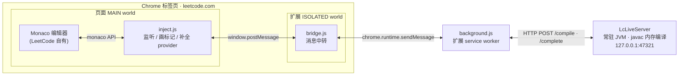
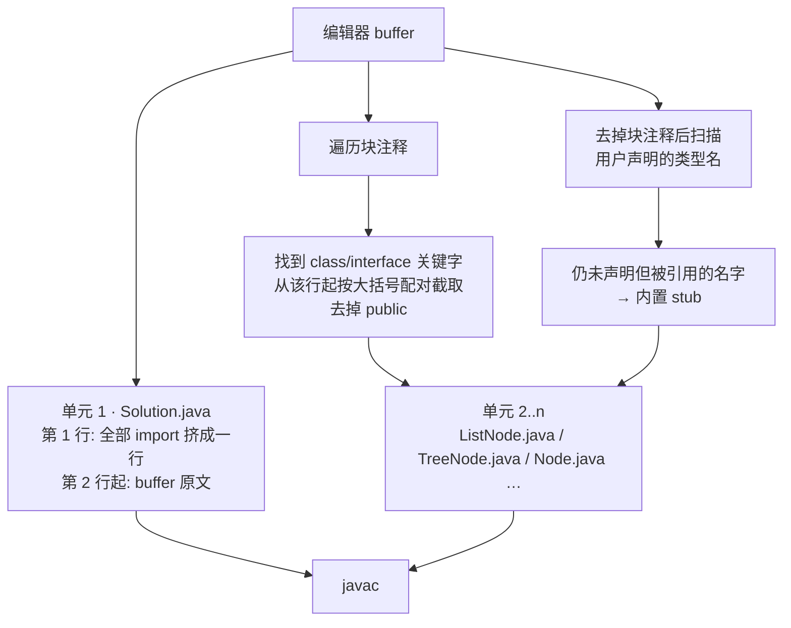
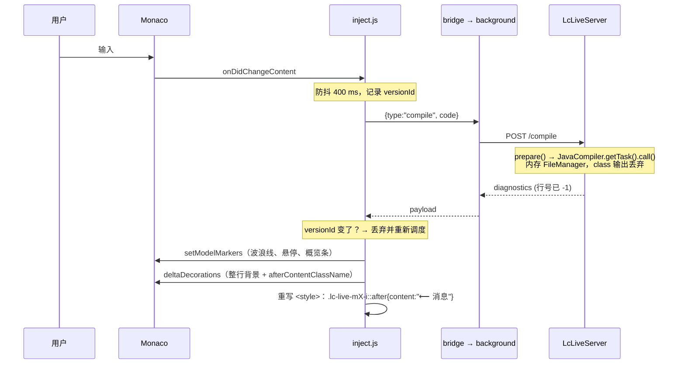
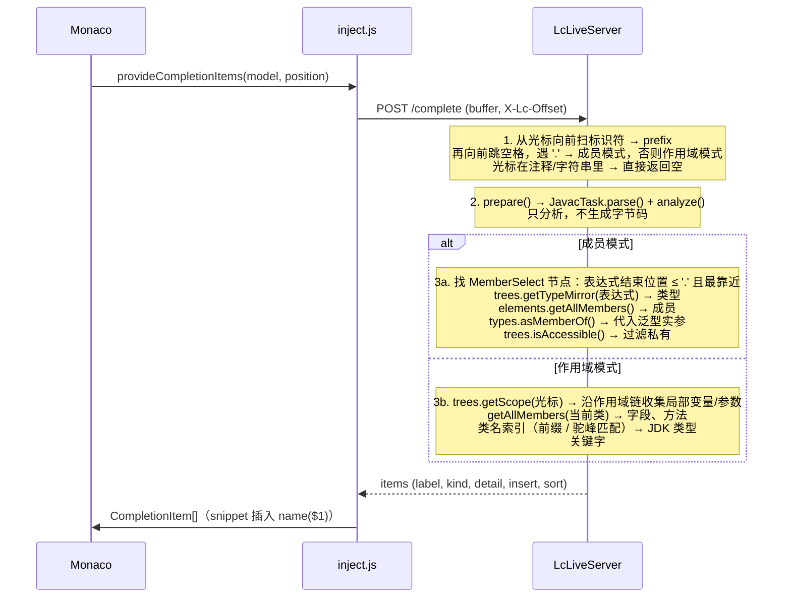
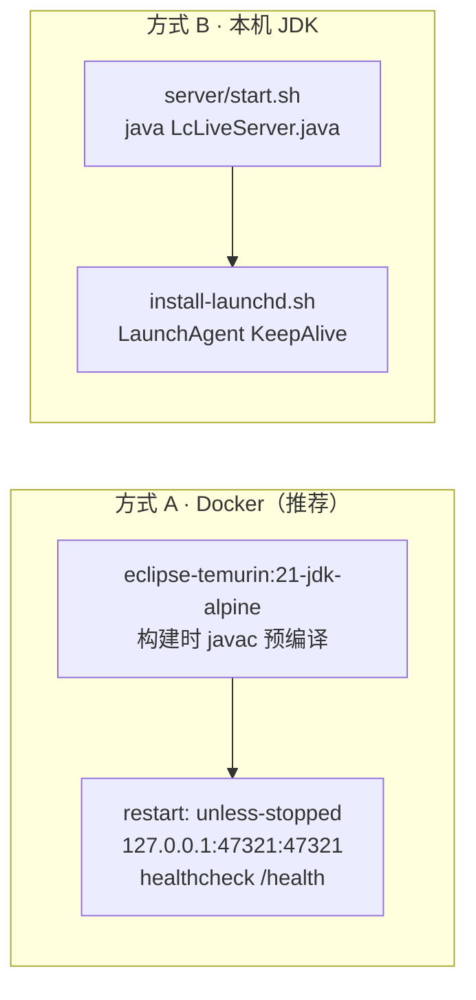

# lc-live 设计文档

[English](DESIGN.md) | 中文

| | |
|---|---|
| 状态 | 已实现 (v0.1) |
| 作者 | haotian-zz |
| 日期 | 2026-10-17 |
| 范围 | Java；Chrome；macOS 本机或 Docker 部署 |

## 1. 背景与问题

在 Chrome 里刷 LeetCode 时，编辑器只有在点「Run」之后才会告诉你代码编不过。LeetCode 自带的 Auto（智能提示 / 检查）依赖它的远端服务，经常断线、延迟高、时有时无，无法当作可靠的工作流依赖。

我们想要的是 IDE 的两项基本体验，并且完全跑在本机、不依赖 LeetCode 的任何后端：

1. **实时编译诊断**：停止输入后几百毫秒内，错误行出现波浪线和行尾提示。
2. **自动补全**：类名前缀、`.` 后的成员（含泛型代入后的签名）、作用域内的变量和方法。

## 2. 目标与非目标

**目标**

- 诊断和补全的端到端延迟在 100 ms 量级，感知上即时。
- 诊断结果与 LeetCode 真实提交时的 javac 行为一致：相同的隐式 import、相同的辅助类（`ListNode`、`TreeNode`、`Node`、交互题的父类）。
- 零第三方依赖。服务端只用 JDK 自带的 API；扩展只用 Chrome 原生 API。
- 对页面无侵入：不改 LeetCode 的 DOM 结构，不劫持它的网络请求，随时可以关掉。
- 一条命令部署，服务随系统自动拉起。

**非目标**

- 不运行用户代码，不跑测试用例。
- 不做重构、跳转定义、格式化等完整语言服务器功能。
- 暂不支持 Java 以外的语言（架构上预留了 `languages` 字段）。
- 不处理 LeetCode 页面以外的编辑器。

## 3. 总体架构

系统由三个进程协作：LeetCode 页面里的 Monaco 编辑器、Chrome 扩展、本机常驻的 JVM 编译服务。



### 3.1 为什么是三跳

这条链路看起来绕，但每一跳都是被 Chrome 的隔离模型逼出来的：

| 约束 | 后果 |
|---|---|
| `window.monaco` 是页面自己的 JS 对象，内容脚本默认运行在 ISOLATED world，看不到页面变量 | 操作编辑器的代码必须以 `world: "MAIN"` 注入 |
| MAIN world 的脚本没有 `chrome.runtime` 等扩展 API | 需要一个 ISOLATED world 的中转脚本，两者通过 `postMessage` 通信 |
| 从 `https://leetcode.com` 直接 `fetch("http://127.0.0.1")` 会触发 Chrome 的本地网络访问限制（实测请求会挂起） | 最终请求由扩展的 service worker 发出，它持有 `host_permissions`，不受此限制 |

### 3.2 组件职责

| 组件 | 文件 | 职责 |
|---|---|---|
| 注入脚本 | `extension/inject.js` | 轮询等待 `window.monaco`；跟踪所有 `java` 语言的 model；防抖后发编译请求；把诊断画成 marker、整行背景、行尾提示；注册 `CompletionItemProvider`；右下角状态胶囊 |
| 中转脚本 | `extension/bridge.js` | 把页面消息原样转给 service worker，把响应原样发回。无业务逻辑 |
| Service worker | `extension/background.js` | 唯一和编译服务通信的地方。超时控制、端口配置（`chrome.storage`）、健康检查 |
| 弹窗 | `extension/popup.*` | 显示服务状态，修改端口 |
| 编译服务 | `server/LcLiveServer.java` | HTTP 服务；源码拼装；javac 内存编译；基于 Trees API 的补全；类名索引 |
| 部署 | `Dockerfile`、`compose.yml`、`server/*.sh` | 容器化（JDK 21）或本机 launchd 两种自启方式 |

## 4. 服务端接口

服务只监听回环地址，请求体是原始 Java 源码（`text/plain`），避免在零依赖的服务端写 JSON 解析器。

### `GET /health`

```json
{"ok":true,"service":"lc-live","java":"21.0.12.1","languages":["java"],
 "features":["diagnostics","completion"],"indexedTypes":493}
```

### `POST /compile`

请求体：编辑器 buffer 原文。

```json
{"ok":false,"ms":16,"diagnostics":[
  {"line":9,"col":20,"endLine":9,"endCol":21,"severity":"error",
   "message":"incompatible types: int cannot be converted to String"}]}
```

行列号均为 1-based，且已映射回用户 buffer 的坐标。

### `POST /complete`

请求体：buffer 原文；请求头 `X-Lc-Offset`：光标在 buffer 中的 UTF-16 偏移（与 Monaco 的 `getOffsetAt` 一致）。

```json
{"ok":true,"ms":12,"incomplete":false,"items":[
  {"label":"peek","kind":"method","detail":"() : Integer","doc":"Deque",
   "insert":"peek()","snippet":false,"sort":"1peek"}]}
```

`incomplete=true` 表示结果被截断（例如空前缀下不列全部 JDK 类型），Monaco 会在用户继续输入时重新请求。

## 5. 源码拼装（prepare）

LeetCode 提交时会在用户代码外面包一层：隐式 import 一组包，并把题目相关的辅助类放进编译。为了让本地 javac 的判断和线上一致，服务端对每次请求做同样的拼装。



设计要点：

- **import 全部放在一行**。用户代码的行号只整体偏移 1，诊断映射只需减 1；多行 import 会让映射依赖 import 数量。
- **注释里的定义是真的参与编译**。LeetCode 把 `ListNode` 等定义放在文件开头的 `/** ... */` 里，有时是 `/* // Definition for a Node. class Node {...} */` 的形式。服务端剥掉 `*` 和 `//` 前缀后，从 `class` 关键字所在行开始做大括号配对，截到对应的 `}`。前后的英文说明文字自然被丢弃。
- **stub 只在缺失时补**。内置了 `ListNode`、`TreeNode`、`Node`（字段取各题的并集）、`NestedInteger`、`GuessGame`、`VersionControl`、`MountainArray` 等。只要用户代码或注释里已经声明同名类型就不注入，避免 duplicate class。
- **辅助类型是独立编译单元**。它们不占用用户 buffer 的行号；如果 stub 自身报错，诊断会钉在第 1 行并加 `[in X.java]` 前缀而不是错位。
- **单元命名**。用户代码里若有 `public class X`，主单元命名为 `X.java`，否则 `Solution.java`，满足 javac 对 public 类文件名的要求。

## 6. 诊断链路



### 6.1 编译选项

```
-proc:none -Xlint:none -g:none -Xmaxerrs 200 -encoding UTF-8 -XDshould-stop.ifError=FLOW
```

`-XDshould-stop.ifError=FLOW` 是关键。javac 默认遇到语法错误就停在解析阶段，只报「`';' expected`」；打开后它会继续完成属性分析和流分析，于是缺分号和未定义变量会同时报出来，这才是 IDE 的行为。

### 6.2 错误范围

javac 给出的是字符偏移 `start/end`。对零宽度的诊断（比如缺分号指向上一个 token 的末尾），服务端把范围向右扩到标识符结尾，或至少扩一列，保证 Monaco 有可见的波浪线，且不跨行。客户端再按 model 的实际行长做一次钳制。

### 6.3 行尾提示为什么用 CSS 伪元素

Monaco 有两种在行尾画文字的方式：

| 方式 | 机制 | 问题 |
|---|---|---|
| `after: { content }` (injected text) | 文字作为真实 DOM 文本插入视图行 | 会被鼠标选中、整行选择时高亮覆盖它、光标可停在上面 |
| `afterContentClassName` + `::after` | 只插入一个空 `<span>`，文字由 CSS `content` 画 | 伪元素不在 DOM 文本里：选不中、复制不到、光标落不上 |

选择后者。每次应用诊断时，为每条消息生成一个唯一类名并重写一个 `<style>` 元素；清除诊断时清空它。类名包含 model id，多个 model 互不干扰。

## 7. 补全链路



### 7.1 处理「写了一半」的代码

正在输入 `dq.pe` 的那一行必然还没有分号。javac 的解析器会报错但继续恢复，把这条语句包进一个 `Erroneous` 节点，而 `dq.pe` 本身被解析为 `MemberSelect(dq, pe)`；若 `.` 后面什么都没有，名字会是 `<error>`。两个坑：

1. `com.sun.source.util.TreeScanner` 的 `visitErroneous` 默认**不**遍历子树，`Trees.getPath()` 内部同样如此。服务端覆写了 `visitErroneous` 让遍历进入 `getErrorTrees()`，并用 `TreePathScanner` 自己记录路径，而不是事后调用 `getPath()`。
2. 好在 `Attr` 阶段会给 `Erroneous` 内部的子树赋类型，所以 `dq` 的 `TypeMirror` 是可用的。这依赖 §6.1 的 `should-stop.ifError=FLOW`，否则分析根本不会执行。

### 7.2 类型分派

| 表达式 | 处理 |
|---|---|
| 变量、方法调用、字面量、`this` | `DeclaredType` → `getAllMembers`，只列非静态成员 |
| 类型名（`Math.`、`Collections.`） | 只列静态成员，外加 `class` |
| 数组 | 加 `length`，其余按 `Object` 处理 |
| 类型变量 `T` | 取上界后处理 |
| 包名（`java.util.`） | 列包内公开类型 |
| 无法解析（`ErrorType`） | 返回空 |

### 7.3 排序与匹配

`sort` 字段用一位数字前缀把候选分层，Monaco 按它排序后再按 label：

```
0 局部变量/参数  <  1 本类或接收者类型自身的成员  <  2 java.util / java.lang 类型
<  3 继承自 Object 的方法  <  4 其他包的类型  <  5 关键字
```

匹配规则：大小写不敏感的前缀匹配，另支持驼峰缩写（`ADe` → `ArrayDeque`、`HM` → `HashMap`）。驼峰匹配要求至少两个字符且首字母相同，否则单个字母会匹配到大量无关类型。

### 7.4 类名索引

启动时在后台线程用 `Elements.getPackageElement(pkg).getEnclosedElements()` 枚举 LeetCode 隐式导入的包（`java.lang`、`java.util`、`java.util.stream`、`java.util.function`、`java.math`、`java.util.concurrent`、`java.io`、`java.text`、`java.util.regex`、`java.lang.reflect` 等），只保留 `public` 顶层类型，约 490 个，耗时不到 100 ms。索引内容只有名字、包、种类三个字符串，与具体的 javac 任务无关，可长期缓存。

### 7.5 客户端

- LeetCode 创建的 Monaco 把 `quickSuggestions` 关了，因此只有输入 `.` 才会弹框。扩展在跟踪到的 Java 编辑器上调用 `updateOptions` 打开它，并关闭 Monaco 自带的基于单词的补全以免混入噪音。
- 有参方法以 snippet 形式插入 `name($1)`，光标停在括号内；无参方法插入 `name()`。
- 同一个单词内继续输入时，Monaco 用上次结果本地过滤，不再请求服务端；只有新单词或 `.` 才会打到服务端。

## 8. 一致性与并发

- `compile()` 与 `complete()` 都用服务实例级别的锁串行化：javac 的 `StandardJavaFileManager` 不保证线程安全，而单用户场景下串行完全够用。
- 客户端记录发送请求时的 `model.getVersionId()`；响应回来时若版本已变，直接丢弃并重新调度，避免把旧诊断画到新代码上。
- 每个 model 同一时刻最多一个在途编译请求，期间的变更合并为一个 `dirty` 标记。
- 服务不可达时客户端进入 offline 状态，清空标记，每 5 s 重试一次；补全在 offline 期间直接返回空，不阻塞编辑。

## 9. 性能

| 环节 | 做法 | 效果 |
|---|---|---|
| 进程 | JVM 常驻，启动时先编译一个样例预热 JIT | 首次请求也在几十毫秒 |
| I/O | 源码是 `SimpleJavaFileObject`，class 输出写入丢弃流 | 全程不落盘 |
| 补全 | 只到 `analyze()`，不做 `generate()` | 省掉代码生成 |
| 请求量 | 400 ms 防抖 + versionId 去重 + Monaco 本地过滤 | 正常打字每秒不超过两三次请求 |
| JVM 参数 | `-Xms64m -Xmx512m -XX:+UseSerialGC -XX:TieredStopAtLevel=1` | 内存小，启动快，C1 对这种短任务足够 |

实测：典型题目的编译 10–25 ms，补全 10–30 ms，端到端感知即时。

## 10. 安全与隐私

- 服务只处理源码文本，不执行任何用户代码（没有 `generate` 之后的加载和运行）。
- 本机运行时绑定 `127.0.0.1`；Docker 运行时容器内绑 `0.0.0.0`，但端口只发布到宿主 `127.0.0.1`，局域网不可达。
- 扩展的 `host_permissions` 只包含 `127.0.0.1` 和 `localhost`，内容脚本只匹配 `leetcode.com` 和 `leetcode.cn`。
- 代码不会离开本机。CORS 头虽然放开，但实际只有扩展 service worker 会访问。
- 请求体上限 512 KB。

## 11. 部署



Docker 方式的好处是 JDK 版本与 LeetCode 一致（21），不受本机 JDK 影响；容器随 docker daemon 自动恢复。daemon 自身的开机启动由后端负责（如 `brew services start colima`）。两种方式都占用 47321 端口，二选一。

## 12. 已知限制与后续工作

- **语言**：目前只有 Java。架构上 `/health` 的 `languages` 字段和客户端按 `languageId` 分派已预留扩展点；C++ 可用 clangd，Python 可用 pyright，都需要新的服务端实现。
- **诊断粒度**：javac 对某些语法错误的恢复会产生级联误报，IDE 也有同样问题，但 IntelliJ 的恢复更好。
- **补全范围**：不含参数名提示（JDK class 文件不带参数名）、不含 import 外的类型、不含构造器参数提示、不含文档注释。
- **编辑器版本**：依赖 Monaco 的 `afterContentClassName`，已在当前 LeetCode 使用的版本上验证；若 LeetCode 升级 Monaco 移除该选项，需切换为 content widget 实现。
- **多 model**：状态胶囊只跟随当前编辑器，分屏场景只显示一个。
- **扩展分发**：目前以「加载已解压的扩展程序」方式安装，未上架商店。

## 13. 测试

- 服务端：`curl` 直接打 `/compile` 和 `/complete`，覆盖普通错误、链表题注释定义、Node 图题、LRUCache 设计题、`public class Solution extends GuessGame`、数组、`this`、链式调用、字符串字面量接收者、注释/字符串内不触发等场景。
- 客户端：在真实 LeetCode 页面注入等价脚本，验证 marker 渲染、伪元素提示的不可选中性、CompletionItemProvider 被调用且候选正确显示。
- 调试：`LC_LIVE_DEBUG=1` 打开服务端补全日志；浏览器 DevTools 里 `__lcLive.status()` 查看扩展连接状态。
